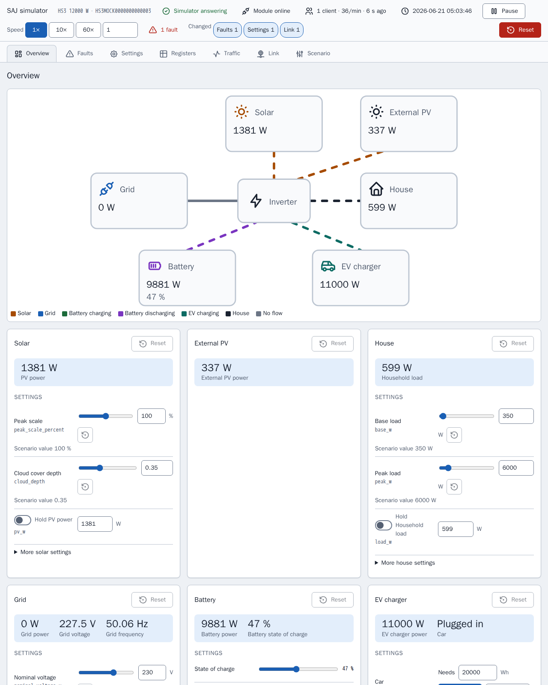

[en](../../en-gb/developer/README.md) | [de](../../de/developer/README.md) | [nl](../../nl/developer/README.md) | [fr](../../fr/developer/README.md) | zh | [es](../../es/developer/README.md) | [it](../../it/developer/README.md) | [pl](../../pl/developer/README.md) | [sv](../../sv/developer/README.md)

# SAJ Local 开发者文档

SAJ Local 如何构建、检查和发布，以及每个部分的权威依据在哪里。文档说明项目为何这样构建，并链接到保存每个事实的文件。版本、命令列表和寄存器映射保存在代码和配置中，而不在这里。

要获得可用的检出副本并提交更改，请从 [CONTRIBUTING.md](../../../CONTRIBUTING.md) 开始。SAJ Local 是仅限本地的 Home Assistant 集成：SAJ Local 通过本地网络与逆变器通信，不添加任何云服务或配套 SDK。

## 没有逆变器时开发

模拟器是一台替身 SAJ 设备，因此大多数工作不需要硬件。每个模拟器都提供一个页面，显示被模拟的系统正在做什么，并让开发人员在 Home Assistant 轮询期间更改该系统，而无需编辑场景并重启。

[Modbus 模拟器](simulator.md)说明模拟器的用途以及如何运行场景。[模拟器页面](simulator-page.md)展示该页面的每个视图。

## 页面

- [Modbus 模拟器](simulator.md)：模拟器的用途、场景以及运行另一个系统。
- [模拟器页面](simulator-page.md)：该页面的每个视图、寄存器检查器、流量日志、链路故障、预设和已保存的状态。
- [环境](environment.md)：设置检出副本，并用模拟器运行开发用的 Home Assistant。
- [检查](checks.md)：make 目标、覆盖率门槛以及如何缩小一次运行的范围。
- [架构](architecture.md)：SAJ 库和集成、型号配置、目录、轮询和稳定名称。
- [前端](frontend.md)：卡片源码、构建和展示仪表盘。
- [文档](documentation.md)：这些页面、生成的实体参考和截图如何制作和检查。
- [发布](releasing.md)：Home Assistant 版本升级以及发布之前的步骤。

用户文档在[用户文档](../user/README.md)中。

## 权威依据在哪里

| 问题 | 权威依据 |
| --- | --- |
| 项目必须做什么？ | [全局需求](../../../.github/work/requirements.md)、[集成需求](../../../custom_components/saj_local/docs/requirements.md)、[卡片需求](../../../frontend/docs/requirements.md)、[模拟器需求](../../../mock/docs/requirements.md) |
| 每个部分目前做什么？ | [集成功能](../../../custom_components/saj_local/docs/features.md)、[卡片功能](../../../frontend/docs/features.md)、[模拟器功能](../../../mock/docs/features.md) |
| 代码、测试和文档如何编写？ | [code-style.md](../../../.github/work/code-style.md) |
| 在这里工作的每个人要遵守哪些规则？ | [AGENTS.md](../../../AGENTS.md) |
| 构建了什么，为什么？ | [done/index.md](../../../.github/work/done/index.md) |
| 计划了什么？ | [.github/work/future/](../../../.github/work/future/) |
| 有哪些命令？ | [Makefile](../../../Makefile) |
| CI 运行什么？ | [ci.yml](../../../.github/workflows/ci.yml) |
| Python 依赖和工具设置 | [pyproject.toml](../../../pyproject.toml) |
| 前端依赖和脚本 | [frontend/package.json](../../../frontend/package.json) |
| 开发服务 | [compose.yaml](../../../compose.yaml) |

现有代码对需求没有权威性。两者不一致时，要么代码有误，要么由负责人更改需求。

## 代码风格

[code-style.md](../../../.github/work/code-style.md) 是权威依据。code-style.md 的文档规则决定了这些页面的写法：解释为什么，而不是怎么做，其余交给名称和类型来描述。
