[en](../../en-gb/developer/simulator-page.md) | [de](../../de/developer/simulator-page.md) | [nl](../../nl/developer/simulator-page.md) | [fr](../../fr/developer/simulator-page.md) | zh | [es](../../es/developer/simulator-page.md) | [it](../../it/developer/simulator-page.md) | [pl](../../pl/developer/simulator-page.md) | [sv](../../sv/developer/simulator-page.md)

# 模拟器页面

模拟器的控制页面：视图、寄存器检查器、流量日志、链路故障、故障效果、预设和已保存的状态。页面本身只有英文，因此其名称在本说明中保持英文。

该页面涵盖内容的完整列表见功能列表中的以下几节：[控制页面](../../../mock/docs/features.md#control-page)、[状态与预设](../../../mock/docs/features.md#state-and-presets)、[寄存器检查器与流量日志](../../../mock/docs/features.md#register-inspector-and-traffic-log)、[链路故障](../../../mock/docs/features.md#link-faults)。

每个模拟器都在 `http://localhost:<panel port>/` 提供一个网页：`make up` 启动的 HS3 为 `5080`，H2 为 `5081`（`SAJ_MOCK_PANEL_HOST_PORT` 和 `SAJ_MOCK_H2_PANEL_HOST_PORT` 可更改这两个端口）。在容器内部，页面监听 `server.panel_port`，默认为 8080。页面没有身份验证：模拟器是开发工具。

该页面的存在是为了让开发人员看到被模拟的系统正在做什么，并在不编辑场景、不重启的情况下让系统进入某种情形。页面根据设备的描述构建每个控件，因此页面只列出已安装的设备。
页面每 3 秒轮询一次状态，因此从 Home Assistant 做出的更改会显示出来，打开 Registers 和 Traffic 视图时，这两个视图还会每秒刷新一次。获得焦点的控件不会被覆盖。两个客户端可以同时更改内容：以最后一次写入为准，与真实设备一样。每次更改都会显示一条简短的确认，每次拒绝都会显示原因。

每个视图上的状态栏回答模拟器是在按场景运行还是已被更改：模块是否在线、已连接的客户端及其请求速率、模拟时间、运行与暂停、速度、活动的故障，以及相对于生效中的场景的每一类更改各一个标签。同一份摘要（状态中的 `changes`）会标记已更改的行和卡片。Pause 把速度设为 0，play 则恢复先前的速度，因此暂停不会丢失速度。

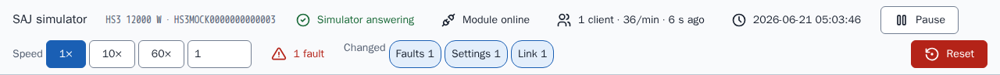

当前视图保存在 URL 片段中（`#registers`），因此重新加载后仍保持该视图。浏览器中不保存任何内容。下面各视图的截图是在设置了一个故障“Fan 1 fault”并且模拟器拒绝了一个寄存器之后截取的，因此每个视图都显示出相对于场景的更改。

页面根据字段名称生成易读的名称，并把每个缩放后的值舍入到其比例的小数位数，因此比例为 0.0001 时，原始值 65535 显示为 6.5535，而不是带有浮点噪声的数字。

## 视图

### 概览 (Overview)

已安装设备的功率流图，按方向着色并带有动画，图下方为每台设备一张卡片。卡片包含实时读数、设定读数的控件以及该设备的故障，并带有把该卡片重置为场景的操作。

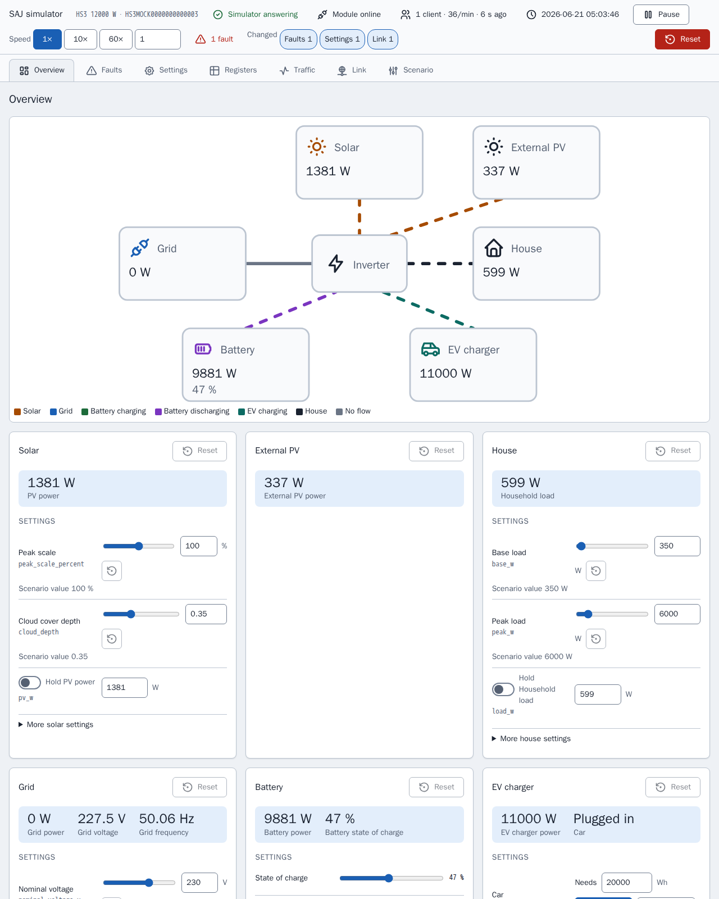

H2 页面的卡片比上面的 HS3 页面少，因为 H2 场景安装的设备更少。

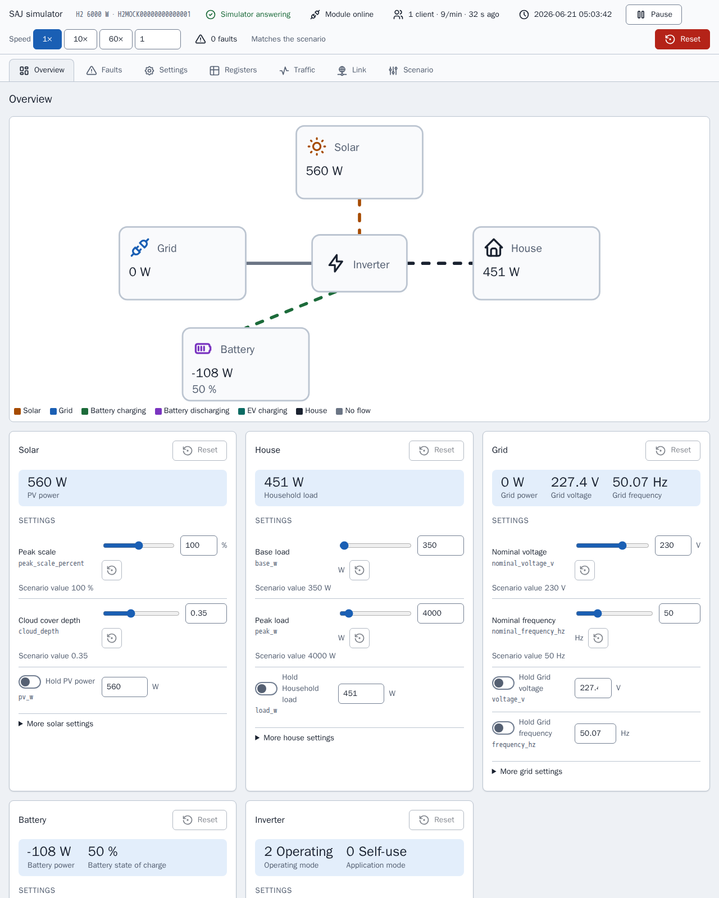

卡片把控件设定的值与该控件产生的读数分开保存，因为一旦涉及保持、故障或荷电状态，二者就会不同：峰值比例为 100% 并不意味着光伏功率的 100%。卡片的重置会恢复该卡片的变化量、保持和故障位，而对荷电状态、电动汽车、时钟和电量计数器不做处理，原因与预设相同。带有活动故障的卡片会被标记，如下面的卡片所示。

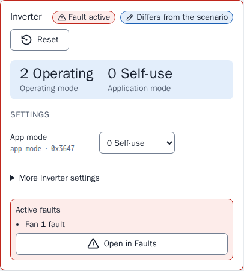

### 故障 (Faults)

已安装设备的每个故障位，可搜索，并说明该位被设置时模拟器的行为。文档中没有命名的位列为保留位，因此可以试用集成对无法识别的故障的处理路径。

图中显示搜索“Fan”的结果，列出四个风扇故障，已设置的故障“Fan 1 fault”的开关处于打开状态。

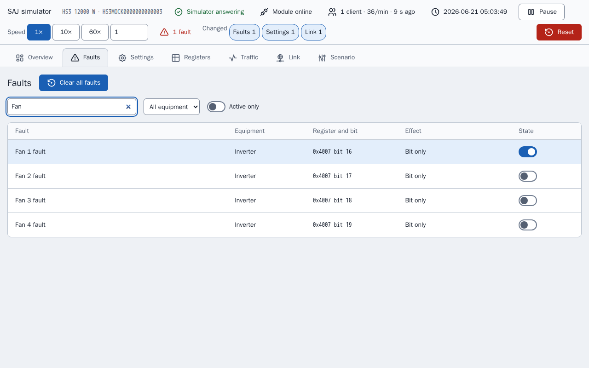

### 设置 (Settings)

可写入的设置和命令，附有原始值的名称以及每项的场景值。

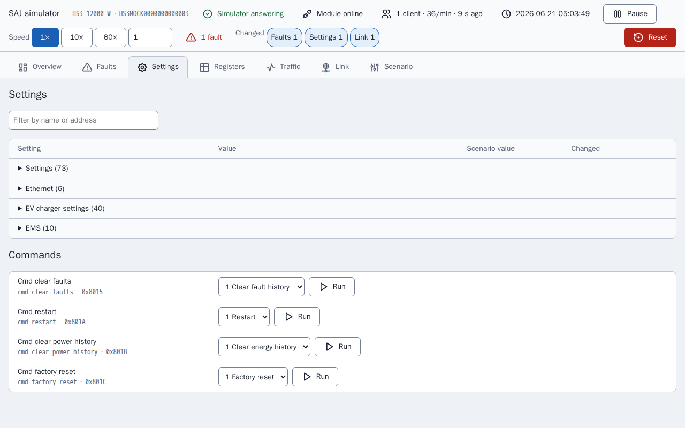

### 寄存器 (Registers)

寄存器检查器，见下文。

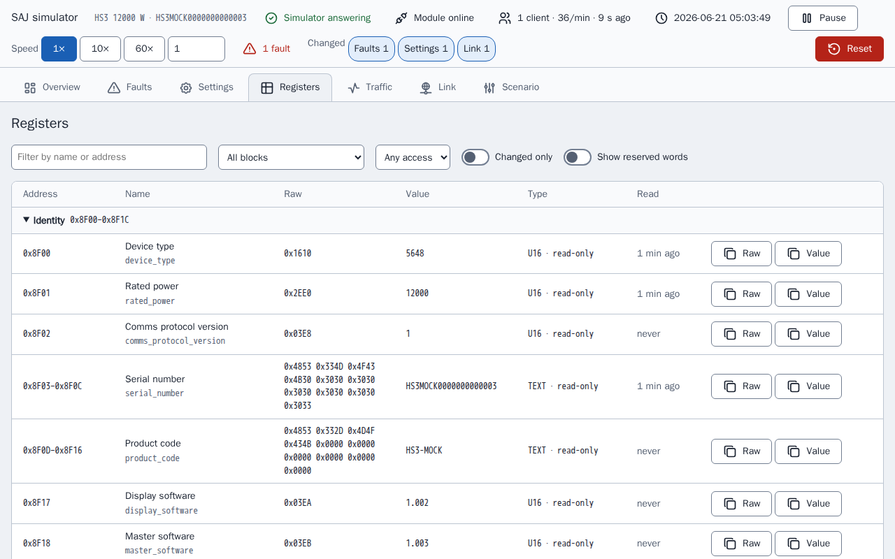

### 流量 (Traffic)

流量日志，见下文。

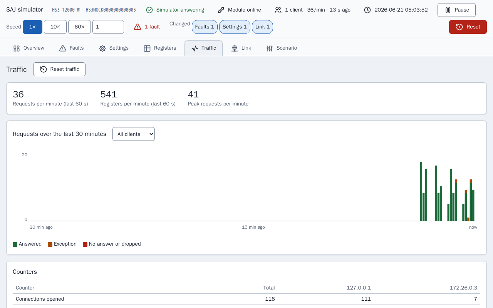

### 链路 (Link)

链路故障和模块状态，见下文。

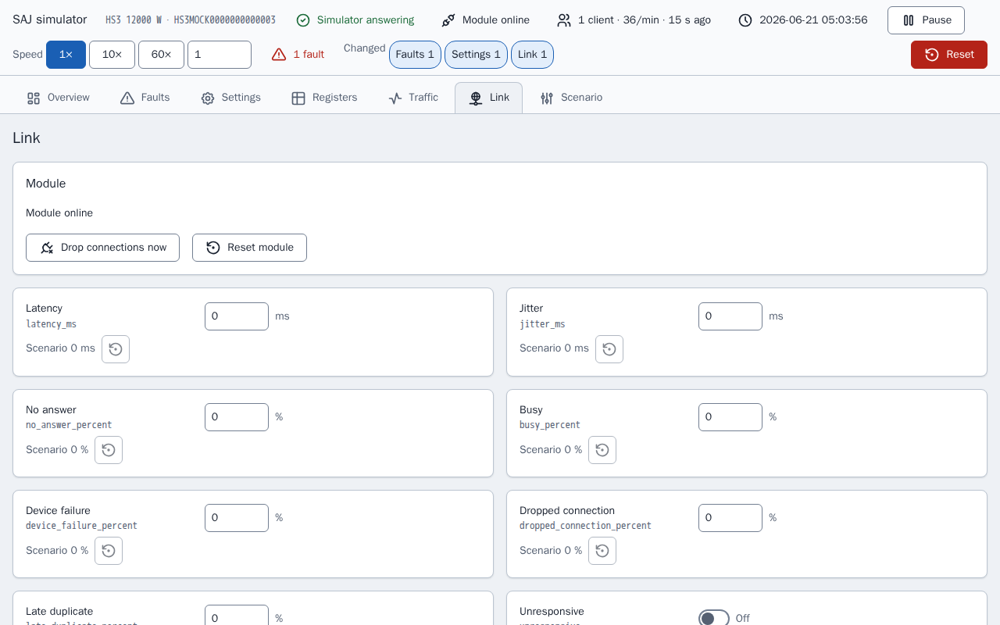

### 场景 (Scenario)

预设、模拟时间、电量计数器、重置和导出。

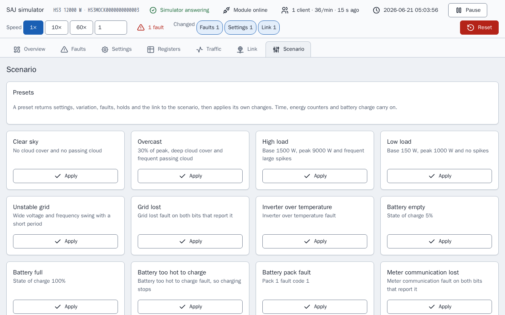

## 寄存器检查器

`GET /api/registers` 列出设备的每个数据块，并对每个有应答的数据块的每个字段给出原始字、带标签的解码值、访问方式（只读、可写或命令）以及客户端上次读取该字段的时间。Registers 视图把该列表显示为带过滤器、“changed only”开关以及对刚变化的值高亮的表格，因此无需 Modbus 客户端就能看到故障或写入对寄存器的影响。

检查器只负责显示。检查器读取设备时不经过设备的观察者，因此查看寄存器不是客户端读取：这种查看不算作保活，不会触及一次读取会触及的字段，也不会记录在流量中。寄存器只能通过那些与 Modbus 写入使用同一套校验的控件来写入。

## 流量日志

Modbus 服务器把每个连接事件和每个请求及其应答报告给记录器（`traffic.py`）。`GET /api/traffic?after=<sequence>` 返回某个序号之后的条目，因此页面只请求新增内容，并同时返回计数器以及按 10 秒分桶的 30 分钟历史；`POST /api/traffic/reset` 会清除这些内容。Traffic 视图显示实时请求速率、请求随时间变化的图表、每个客户端的计数器以及日志，日志可以过滤，并可展开查看读取或写入的字。图中显示只列出错误、并展开了一个被拒绝请求的日志：被拒绝的请求没有字，因此该条目对此加以说明，并指出拒绝该请求的链路故障。

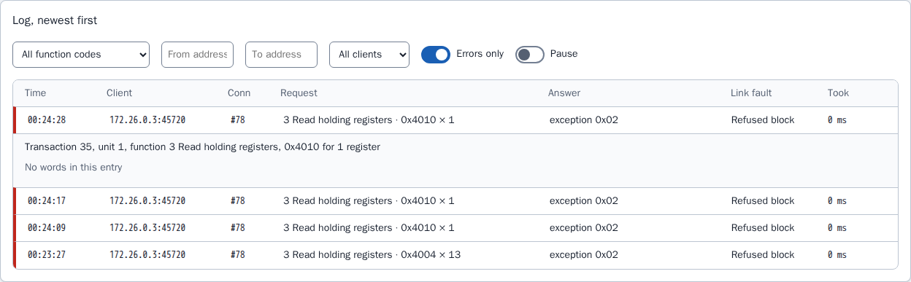

计数器统计请求数和寄存器数，因为现场报告就是这样描述模块负载的，并且两者都显示，因为请求大小是否也有影响尚不清楚。记录器在内存中保留最近 2000 条记录，且不保存：日志描述的是模拟器当前这次运行中发生的事，重启就是一次新的运行。

## 链路故障

Link 视图和场景的 `link` 部分设置被模拟的模块如何出现异常。每项设置都重现现场报告中所描述的 SAJ 通信模块故障，除非场景或页面设置，否则一项都不会生效。

| 键 | 效果 |
| --- | --- |
| `latency_ms`、`jitter_ms` | 每个应答等待延迟加减最多抖动的时间，0 到 60000 ms |
| `no_answer_percent` | 请求被读取但永远不应答，连接保持打开 |
| `busy_percent`、`device_failure_percent` | 应答为异常 `0x06` 或 `0x04` |
| `dropped_connection_percent` | 模块关闭连接而不是应答 |
| `late_duplicate_percent` | 在一次异常应答之后，同一帧在该连接上的下一次应答之前再次发出 |
| `refused_blocks` | 由 `start`、`end` 和 `code`（0 到 255）组成的列表。触及该数据块的请求以该代码应答，因此可以服务发送非标准代码（包括 0）的设备 |
| `unresponsive` | 接受连接，但从不应答 |
| `offline` | 模块停止监听并关闭每个连接 |
| `offline_seconds`、`offline_period_seconds` | 在每个周期的前 `offline_seconds` 秒内离线，周期必须至少与之一样长 |
| `lockout_requests`、`lockout_window_seconds`、`lockout_whole_port` | 在窗口内发送超过 `lockout_requests` 个请求的客户端，其连接被关闭且其地址被拒绝；设置了 `lockout_whole_port` 时则对每个客户端如此，直到模块被重置。设置了阈值时必须设置窗口 |

<!-- jscpd:ignore-start -->
```yaml
link:
  latency_ms: 800
  jitter_ms: 400
  busy_percent: 10
  refused_blocks:
    - {start: 0x4000, end: 0x40FF, code: 0}
```
<!-- jscpd:ignore-end -->

百分比为 0 到 100。错误的值或无法工作的组合会使模拟器在启动时停止，并指出键名，例如 `link.offline_seconds`。

决策在 `link.py` 中做出，由传输层执行，传输层在接受连接之前和应答之前都会询问链路。第一个适用的检查决定结果，顺序为：离线、无响应、锁定、断开连接、无应答、被拒绝的数据块、设备故障、忙碌。延迟适用于每个发出的应答。某个概率是否生效，由模拟种子和请求的序号抽取，因此相同的种子和相同的请求会产生相同的故障，调试时发现的故障可以重现。延迟、离线周期和锁定窗口按实际时间运行，而不是模拟时间，因为这些设置描述的是客户端所看到的链路，时钟速度不得改变这些设置。

链路设置和锁定在重启后会保留，并随场景一起导出。锁定只会被“Reset module”、Reset 或预设清除，因为现场报告描述了锁定一直持续到模块被分配新地址，而“Reset module”就代表新地址。“Drop connections now”会把每个已打开的连接关闭一次。相应的路由是 `POST /api/link`、`/api/link/drop` 和 `/api/link/reset`。

流量记录器显示每个请求应用了哪个故障，因此可以从日志中读出某项设置对客户端的影响。

## 故障效果

有些故障在真实系统中会做出比设置其位更多的事情。名称涉及电网、光伏、直流母线、电池端口、温度、继电器、传感器或绝缘状况的故障会使逆变器停机，电网丢失会使逆变器离网运行，电表通信丢失会使电表 A 静默，一些电池故障会停止充电或放电，任何不为 0 的电池包故障代码会同时停止两者，充电桩故障会停止充电桩。其他每个故障以及每个保留位只设置该位。相应的表在 `mock/saj_local_mock/profiles/fault_tables.py` 中，效果由 `simulation/faults.py` 应用。

## 预设、已保存的状态和导出

**预设**先把设置、变化量、种子、故障和保持恢复为场景，再应用其更改，因此无论模拟器之前处于什么状态，每个预设都给出相同的条件。模拟时间、时钟速度、电量计数器和电池荷电状态会继续，除非预设设置了这些值，这样 Home Assistant 不会看到时钟倒退或累计总量下降。**Reset** 才是把一切倒回的操作。未安装的设备没有预设，其表中没有该故障的型号也没有。预设还会把链路恢复为场景，再设置自己对链路的更改，并清除锁定。链路预设对每个型号都提供：Slow link、Flaky link、Busy module、Module offline 和 Module locked out。没有现场报告给出模块被锁定时的负载，因此“Module locked out”的阈值只是一个起点，可在页面上更改，并非取自集成的任何限制。

**已保存的状态。** 更改在重启后保存在 `/data/state.json` 中，位于 [compose.yaml](../../../compose.yaml) 中每个服务各一个的绑定挂载文件夹：`mock/state/hs3/` 和 `mock/state/h2/`，删除文件夹内容即可重置。链路设置和锁定随状态一起保存。为其他场景保存的状态会被忽略，并记录一次日志，因为将其应用到另一个系统是错误的。无法读取的状态以同样的方式被忽略，文件会保留。只保存客户端可以写入的设置，因此代码中对固定寄存器的更改绝不会被旧文件掩盖，电量计数器连同每天、每月和每年的起点一起保存，因此重启不是计数器重置。没有挂载文件夹时，模拟器会记录一行日志说明更改不会保留，然后继续运行。**Reset** 会删除该文件并恢复为场景。Playwright 栈不挂载任何文件夹，因此每次运行都从场景开始。

**导出**会把正在运行的种子、变化量、故障、链路和时钟作为场景下载，因此调好的状态可以提交，并在全新的模拟器中以相同的变化量再次运行。

## 图标

页面的图标来自 `mock/static/vendor/tabler/` 下的 Tabler 图标集，因为模拟器必须独立运行，不从外部加载任何内容。只保留页面用到的图标，并保留原始 SVG 文件，因此可以对照来源检查该图标集。该文件夹还包含图标集的 `LICENSE` 和说明图标发布版本的 `README.md`。页面把图标内联，使图标采用文字颜色；不使用图标字体或表情符号。任何采用 MIT 或 ISC 许可证的图标集都可以这样引入，并把其许可证放在旁边。
