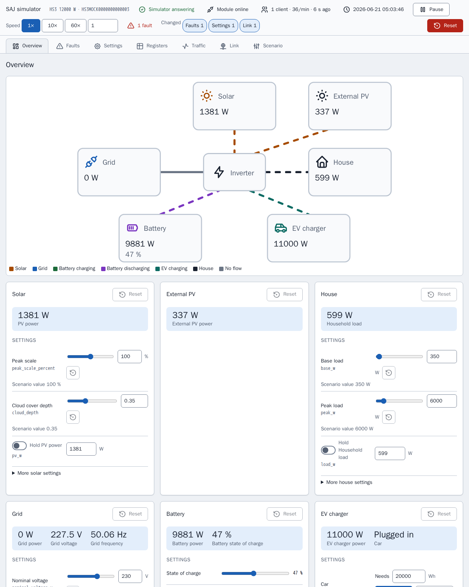

[en](../../en-gb/developer/simulator.md) | [de](../../de/developer/simulator.md) | [nl](../../nl/developer/simulator.md) | [fr](../../fr/developer/simulator.md) | zh | [es](../../es/developer/simulator.md) | [it](../../it/developer/simulator.md) | [pl](../../pl/developer/simulator.md) | [sv](../../sv/developer/simulator.md)

# Modbus 模拟器



模拟器的用途、如何运行和配置场景，以及如何扩展模拟器。

模拟器涵盖内容的完整列表见功能列表中的以下几节：[模拟型号](../../../mock/docs/features.md#simulated-models)、[场景](../../../mock/docs/features.md#scenarios)、[变化量](../../../mock/docs/features.md#variation)。

模拟器是一台替身 SAJ 设备，Home Assistant 或任何 Modbus 客户端都可以连接到它，因此开发集成既不需要拥有硬件，也不会给硬件带来风险。模拟器的目标是可信的冒烟测试，而不是精确仿真，也不是通用的 Modbus 服务器。软件包是 `mock/saj_local_mock/`，每个模拟器在各自的容器中运行。

## 设计决策

- **独立。** 模拟器与集成不共享任何代码，import-linter 约定禁止模拟器导入 Home Assistant 或 `custom_components`。如果双方使用同一份寄存器定义，定义中的错误就会不可见。
- **自己的 Modbus 层。** 真实的 SAJ 设备会违背标准：古怪的异常代码、拒绝跨越其末尾读取的数据块、很低的客户端上限。集成必须能应对这些故障，因此这些故障是内置的。
- **一个容器，一台设备。** 每个实例在 `mock/state/` 下自己的文件夹中保存自己的状态，因此实例之间绝不会互相影响。
- **运行时可更改。** 场景是起点，而不是唯一的输入。模拟器页面和传入的请求会改变运行中的系统，而场景仍是可以回到的已知状态。
- **确定性。** 天气和负载只取决于种子和模拟时间。无论客户端轮询多少次，相同的场景、时刻和写入都给出相同的值。
- **一个能量平衡。** 只生成辐照度和负载，其他一切都由此推导，因此寄存器之间绝不会互相矛盾。
- **写入会生效。** 设置会被存储、读回并据此行动。来自页面的写入经过与 Modbus 写入相同的校验和处理，因此集成分辨不出两者，页面也不能让设备进入客户端无法达到的状态。
- **页面对型号一无所知。** 页面根据设备给出的描述构建自身，因此新增型号无需改动页面。页面是开发工具，所以页面是 `mock/static/` 中的纯 HTML、CSS 和 JavaScript 文件，原样提供，没有库、没有构建步骤，也没有页面自己的测试，而页面背后的 Python 则与其余部分一样接受测试。参见[模拟器页面](simulator-page.md)。
- **模块是模拟的一部分。** Modbus 服务器代表客户端所连接的通信模块，因此现场报告所描述的这些模块的故障（应答缓慢或缺失、古怪的异常代码、连接被断开、锁定）是模拟器的设置，而不是散落在设备各处的特例。
- **写入行为来自 SAJ 文档。** 写入由 SAJ 协议文档和真实读数规定，而不是由模拟器规定。如果模拟器偏离文档规定的 `0x06` 和 `0x10` 行为，这种偏离是需要提出的模拟器缺陷，而不是让集成去绕开的问题。

## 了解全貌

| 想了解 | 查看 |
| --- | --- |
| 模拟器为何这样构建 | 已完成的工作 [构建 SAJ Modbus 模拟器](../../../.github/work/done/build-saj-modbus-mock-simulator.md)、[添加模拟器控制面板](../../../.github/work/done/add-simulator-control-panel.md) 和 [重新设计带检查器和链路故障的模拟器面板](../../../.github/work/done/redesign-simulator-panel-with-inspector-and-link-faults.md) |
| 现成的系统 | [mock/scenarios/](../../../mock/scenarios/) |
| 有效的场景键和默认值 | `mock/saj_local_mock/scenario.py` |
| 每个型号支持什么 | `mock/saj_local_mock/models.py` |
| 寄存器 | `mock/saj_local_mock/profiles/` |
| 值如何演变 | `mock/saj_local_mock/simulation/` |
| 服务和端口 | [compose.yaml](../../../compose.yaml) |
| 模拟器页面 | `panel.py`（路由）、`description.py`、`presets.py` 以及 [mock/static/](../../../mock/static/) 中的页面 |
| 链路故障 | `mock/saj_local_mock/link.py`（设置、范围、决策）和 `transport.py`（执行决策） |
| 流量记录 | `mock/saj_local_mock/traffic.py` |
| 各型号的故障位 | `mock/saj_local_mock/profiles/fault_tables.py` |
| 已保存的状态 | `mock/saj_local_mock/persistence.py` |

传输层对 SAJ 一无所知，设备拥有地址和访问规则，配置文件把寄存器绑定到被模拟的量，而模拟不知道值是如何传输的。把这些层分开，正是每一层都能单独进行单元测试的原因。

## 从终端与模拟器通信

`make up` 启动模拟器。Home Assistant 通过 Compose 服务名在各模拟器自己的端口上访问它们；从你的机器访问时，请使用 `localhost` 和 `compose.yaml` 中发布的端口。

示例对 HS3 模拟器发布的端口使用 [mbpoll](https://github.com/epsilonrt/mbpoll)。`-0` 使地址与寄存器映射一致，`-1` 只读取一次，`-t 4` 选择保持寄存器，`-a` 是单元 ID。

读取设备类型和额定功率（寄存器 `0x8F00` 和 `0x8F01`）：

<!-- jscpd:ignore-start -->
```bash
mbpoll -m tcp -p 5020 -a 1 -0 -1 -t 4:hex -r 0x8F00 -c 2 localhost
```
<!-- jscpd:ignore-end -->

HS3 和 H2 应答的设备类型不同，这是确认某个端口在模拟哪个系统的最快方法。

写入一项设置并读回该设置（这里是 `0x3647` 处的应用模式）：

<!-- jscpd:ignore-start -->
```bash
mbpoll -m tcp -p 5020 -a 1 -0 -t 4 -r 0x3647 localhost 1
mbpoll -m tcp -p 5020 -a 1 -0 -1 -t 4 -r 0x3647 localhost
```
<!-- jscpd:ignore-end -->

查看模拟器如何拒绝一个请求，例如地址在每个数据块之外：

<!-- jscpd:ignore-start -->
```bash
mbpoll -m tcp -p 5020 -a 1 -0 -1 -t 4 -r 0x0001 localhost
```
<!-- jscpd:ignore-end -->

去掉 `-1` 即可观察值的变化；此时 mbpoll 每秒轮询一次，直到停止。

运行模拟器自带的健康检查，无需安装任何客户端：

<!-- jscpd:ignore-start -->
```bash
docker compose exec mock python -m saj_local_mock healthcheck; echo $?
```
<!-- jscpd:ignore-end -->

写入在重启后保存在 `mock/state/` 中，Git 会忽略该文件夹，并可从模拟器页面重置，或删除文件夹内容来重置，参见[已保存的状态](simulator-page.md#预设已保存的状态和导出)。地址来自配置文件；上面三个只是起点。

## 配置场景

场景是挂载在 `/config/config.yaml` 的 YAML 文件。只有 `device.model` 是必需的，因此文件只写出与默认值不同的部分：

<!-- jscpd:ignore-start -->
```yaml
device:
  model: hs3
simulation:
  start: "2026-06-21T12:00:00"
  speed: 600
battery:
  modules: 4
```
<!-- jscpd:ignore-end -->

在示例中，`simulation.speed` 是每个真实秒对应的模拟秒数，因此这会从仲夏正午起每秒运行十个模拟分钟：适合在几分钟内观察完整一天的充电和放电。`simulation.seed` 选择天气和负载。

有两个部分在启动时决定随机行为和故障；第三个部分 `link` 在[链路故障](simulator-page.md#链路故障)中说明。`variation` 设置光伏、负载和电网生成器的范围、深度和周期（负载水平仍在 `site.load` 中），`faults` 按寄存器和位列出每台设备的活动故障位，另加电池包代码：

<!-- jscpd:ignore-start -->
```yaml
variation:
  cloud_depth: 0.9
faults:
  inverter:
    - {register: 0x4005, bit: 23}
  packs:
    - {pack: 1, fault: 1}
```
<!-- jscpd:ignore-end -->

错误的键或不可能的组合会使模拟器在启动时停止，并指出键名。模拟器把该行写到错误输出并退出：

```text
invalid scenario: ev_charger.installed: not available on h2
```

## 运行不同的或额外的系统

**试运行一次场景**，无需改动任何文件。模拟器在前台于自己的端口上运行，直到你停止模拟器：

<!-- jscpd:ignore-start -->
```bash
docker compose run --rm --no-deps -p 5030:502 \
  -v ./mock/scenarios/hs3-off-grid.yaml:/config/config.yaml:ro \
  -v ./mock/state/off-grid:/data \
  mock
```
<!-- jscpd:ignore-end -->

多出的 `-v` 是必需的，因为 `mock` 服务否则会带上 `mock/state/hs3/` 的 `/data` 挂载，离网运行中的第一次更改就会用离网状态替换开发用 HS3 的 `state.json`。离网运行在每次运行之间把自己的状态保存在 `mock/state/off-grid/` 中。

把第一个 `-v` 指向你自己的文件，即可运行你自己编写的场景。

**更改 `make up` 启动的内容**，在 `compose.override.yaml` 中进行。把另一个文件挂载到同一路径会替换场景；新增服务会增加一个系统：

<!-- jscpd:ignore-start -->
```yaml
services:
  mock:
    volumes:
      - ./mock/scenarios/hs3-ev.yaml:/config/config.yaml:ro

  mock-off-grid:
    build:
      context: ./mock
    volumes:
      - ./mock/scenarios/hs3-off-grid.yaml:/config/config.yaml:ro
    ports:
      - "5022:502"
```
<!-- jscpd:ignore-end -->

每个服务都是带有自己状态的独立设备。Home Assistant 以 `mock-off-grid` 访问新服务，因此可以在一个 Home Assistant 中并排添加多个系统。

## 扩展模拟器

- **新场景：** 在 `mock/scenarios/` 中添加一个文件。`make mock-smoke` 会运行该文件夹中的每个文件。
- **新型号：** 在 `models.py` 中添加一项，在 `profiles/` 中添加一个配置文件，并通过 `scenario.py` 中的场景校验。
- **新的怪异行为：** 放在拥有该行为的层中。成帧和连接放在传输层，地址和访问放在设备，型号行为放在配置文件。

模拟器通过与集成相同的关卡，参见[检查页面](checks.md)。
