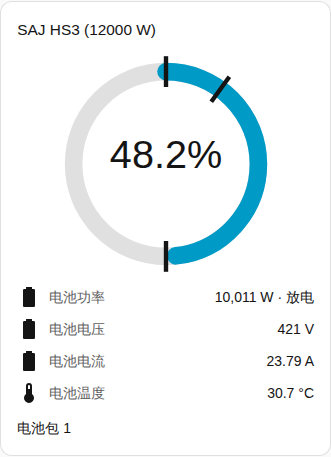
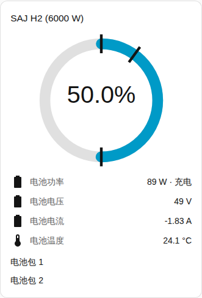

[en](../../../en-gb/user/cards/battery-card.md) | [de](../../../de/user/cards/battery-card.md) | [nl](../../../nl/user/cards/battery-card.md) | [fr](../../../fr/user/cards/battery-card.md) | zh | [es](../../../es/user/cards/battery-card.md) | [it](../../../it/user/cards/battery-card.md) | [pl](../../../pl/user/cards/battery-card.md) | [sv](../../../sv/user/cards/battery-card.md)

# 电池卡片

“电池卡片”页面说明电池卡片，该卡片显示电池的电量、功率和读数。完整列表见卡片功能列表的 [电池卡片](../../../../frontend/docs/features.md#battery-card) 一节。[添加元素](README.md#添加元素)说明如何添加该卡片并选择系统。

## 卡片显示什么

- 圆环显示荷电状态。圆环上的标记显示备用电量、充电限值和并网放电限值。
- 电池功率连同电池正在充电还是放电一起显示，功率下方是电压、电流、温度和可用容量。方向遵循[功率的符号](../entities-and-prefix.md#功率的符号)。
- “显示电池包”开启时（默认开启），每个电池包都有一组行，含荷电状态、健康状态、电压、电流、温度、循环次数、故障和警告。电池包的读数只在该读数的实体已启用时才出现。大多数电池包读数以禁用状态创建，因此截图只显示电池包的名称。请在 Home Assistant 中启用你想要的实体。[电池包实体](../entities/battery-packs.md)在实体参考中。
- 一行在电池充电时显示电池充满所需时间，在电池放电时显示电池放空所需时间。电池空闲时，或系统没有这个实体时，该行不显示。[计算得出的传感器](../entities-and-prefix.md#计算得出的传感器)说明这些估计值。
- 没有电池的系统会说明这一点。

## 型号之间的差异

- **HS3：** 一个电池包。
- **H2：** 逆变器上报的每个电池包各有一组行，最多五个。截图显示的是有两个电池包的 H2。参见[可选设备](../optional-equipment.md#电池包)。

[故障卡片](faults-card.md)列出每个电池包的当前故障和警告。故障和警告实体默认启用。

## 选项

| 编辑器中的选项 | YAML 键 | 默认值 |
| --- | --- | --- |
| 系统 | `device` | 第一个系统 |
| 显示电池包 | `show_packs` | 开 |

## 尚不支持

- 从卡片更改电池设置。电池卡片只显示读数。电池限值请使用[控制卡片](controls-card.md)。
