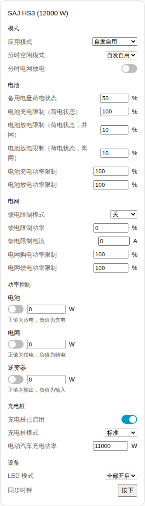
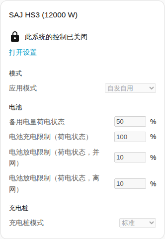
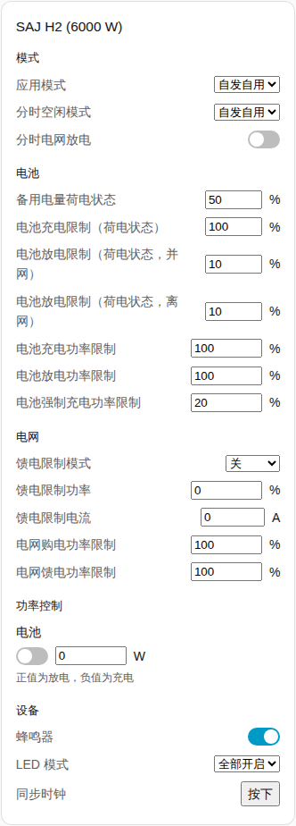

[en](../../../en-gb/user/cards/controls-card.md) | [de](../../../de/user/cards/controls-card.md) | [nl](../../../nl/user/cards/controls-card.md) | [fr](../../../fr/user/cards/controls-card.md) | zh | [es](../../../es/user/cards/controls-card.md) | [it](../../../it/user/cards/controls-card.md) | [pl](../../../pl/user/cards/controls-card.md) | [sv](../../../sv/user/cards/controls-card.md)

# 控制卡片

“控制卡片”页面说明控制卡片，该卡片把系统的设置分区汇集在一起，让你可以在仪表盘上更改这些设置。完整列表见卡片功能列表的 [控制卡片](../../../../frontend/docs/features.md#controls-card) 一节。[添加元素](README.md#添加元素)说明如何添加该卡片并选择系统。控制项背后的设置见[更改设置](../changing-settings.md)。

## 卡片显示什么

- 分区有模式、电池、电网、功率控制、充电桩和设备。没有内容可显示的分区会被省略。
- **模式：** 应用模式和分时设置。
- **电池：** 备用电量以及充电和放电限值。
- **电网：** 馈电限值设置和电网功率限值。
- **功率控制：** 系统具备的每个[功率控制](../power-control.md)功能，附带一个开关、一个功率目标，以及关于正功率和负功率作用的提示。
- **充电桩：** 充电桩的开关、模式和充电功率。
- **设备：** 蜂鸣器、LED 模式和时钟同步。
- 每个设置都使用适合该设置的控件：滑块或数字字段、列表、开关、时间字段或按钮。
- 控件每做出一次决定就更改一次逆变器，然后显示逆变器所保存的值。被拒绝的更改显示在控件下方。
- 该卡片没有“重启逆变器”按钮，因此在仪表盘上点按不会重启逆变器。重启仍是一个实体。

## 不允许控制时

当该系统的[允许控制](../changing-settings.md#允许控制)关闭时，每个控件都被禁用。控件上方的锁链接到集成的设置，你可以在那里开启“允许控制”。

## 型号之间的差异

- **仅 HS3：** 充电桩分区，以及电网和逆变器功率控制功能。
- **仅 H2：** 蜂鸣器和电池强制充电功率限制。H2 只有电池功率控制功能。

## 选项

| 编辑器中的选项 | YAML 键 | 默认值 |
| --- | --- | --- |
| 系统 | `device` | 第一个系统 |
| 分区 | `sections`，由 `mode`、`battery`、`grid`、`power_control`、`ev_charger` 和 `device` 组成的列表 | 所有分区 |

## 尚不支持

- “重启逆变器”按钮。重启仍是一个实体。
- 功率控制计划。请在集成页面设置计划，参见[功率控制](../power-control.md#遵循计划)。
