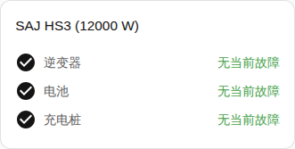

[en](../../../en-gb/user/cards/faults-card.md) | [de](../../../de/user/cards/faults-card.md) | [nl](../../../nl/user/cards/faults-card.md) | [fr](../../../fr/user/cards/faults-card.md) | zh | [es](../../../es/user/cards/faults-card.md) | [it](../../../it/user/cards/faults-card.md) | [pl](../../../pl/user/cards/faults-card.md) | [sv](../../../sv/user/cards/faults-card.md)

# 故障卡片

“故障卡片”页面说明故障卡片，该卡片列出每台设备的当前故障。完整列表见卡片功能列表的 [故障卡片](../../../../frontend/docs/features.md#faults-card) 一节。[添加元素](README.md#添加元素)说明如何添加该卡片并选择系统。这些故障来自[设备故障实体](../faults-and-repairs.md#设备故障)。

## 卡片显示什么

- 故障按逆变器、电池和充电桩分组，每个当前故障都显示该故障已开始多久。电池包的故障和警告在电池分组中。
- 未识别的故障会提示到[诊断下载](../troubleshooting.md#下载诊断)中查看寄存器和位。
- “清除故障”按钮位于逆变器的当前故障下方。该按钮发送“清除当前故障”命令。当该系统不允许控制时，该按钮被禁用，并且一个锁链接到集成的设置。参见[允许控制](../changing-settings.md#允许控制)。
- “显示无故障的分组”开启时（默认开启），没有当前故障的分组显示为正常，如截图所示。该选项关闭时，卡片只显示有当前故障的分组。

没有电池或充电桩的系统，对缺少的设备没有故障可显示，因此卡片不绘制该设备的分组。

## 选项

| 编辑器中的选项 | YAML 键 | 默认值 |
| --- | --- | --- |
| 系统 | `device` | 第一个系统 |
| 显示无故障的分组 | `show_groups_without_faults` | 开 |

## 尚不支持

- 从卡片清除电池或充电桩的故障。“清除故障”按钮只位于逆变器的当前故障下方。
