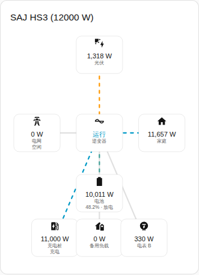
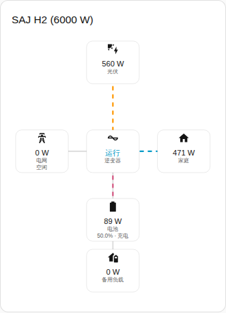

[en](../../../en-gb/user/cards/power-flow-card.md) | [de](../../../de/user/cards/power-flow-card.md) | [nl](../../../nl/user/cards/power-flow-card.md) | [fr](../../../fr/user/cards/power-flow-card.md) | zh | [es](../../../es/user/cards/power-flow-card.md) | [it](../../../it/user/cards/power-flow-card.md) | [pl](../../../pl/user/cards/power-flow-card.md) | [sv](../../../sv/user/cards/power-flow-card.md)

# 功率流卡片

“功率流卡片”页面说明功率流卡片，该卡片绘制光伏、电池、电网、家庭和可选设备之间的实时功率。完整列表见卡片功能列表的 [功率流卡片](../../../../frontend/docs/features.md#power-flow-card) 一节。[添加元素](README.md#添加元素)说明如何添加该卡片并选择系统。



## 卡片显示什么

- 光伏、电池、电网和家庭绘制在逆变器周围，逆变器显示运行状态。
- 每条线显示流动的方向，功率越大，流动越快。10 W 或更低的功率绘制为空闲。
- 电池显示荷电状态以及电池正在充电还是放电。电网显示系统正在购电还是馈电。方向遵循[功率的符号](../entities-and-prefix.md#功率的符号)。
- “显示可选设备”开启时（默认开启），当系统具备这些设备时，卡片还会绘制备用负载、电表 B 和充电桩。电表 B 是没有方向的读数。
- “显示光伏组串”开启时，会列出每路光伏组串的功率。该选项默认关闭。
- “范围”在系统的读数（默认）和并机系统的读数之间选择。没有并机读数的系统在并机范围下显示空状态。

## 型号之间的差异

- **仅 HS3：** 充电桩，如上面的截图所示。
- **H2：** 卡片绘制 HS3 卡片的各个部分，充电桩除外。下面的截图显示的是正在给电池充电的 H2。



## 选项

| 编辑器中的选项 | YAML 键 | 默认值 |
| --- | --- | --- |
| 系统 | `device` | 第一个系统 |
| 显示光伏组串 | `show_strings` | 关 |
| 显示可选设备 | `show_optional_equipment` | 开 |
| 范围 | `scope`（`system` 或 `parallel`） | `system` |

<!-- jscpd:ignore-start -->
```yaml
type: custom:saj-local-power-flow-card
device: 0123456789abcdef0123456789abcdef
show_strings: false
show_optional_equipment: true
scope: system
```
<!-- jscpd:ignore-end -->

`device` 的值是 Home Assistant 中该设备的 ID。可视化编辑器会为你填入该值。每个部分背后的实体名称在[实体参考](../entities/README.md)中。

## 尚不支持

- 电表 B 的方向。卡片把电表 B 绘制为没有方向的读数。
