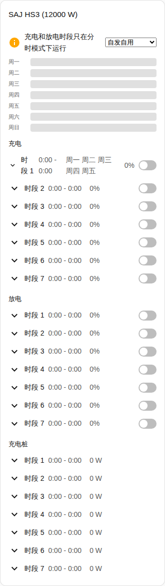
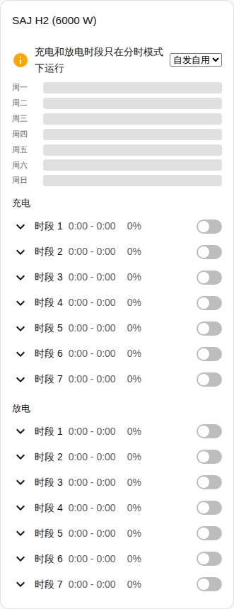

[en](../../../en-gb/user/cards/schedule-card.md) | [de](../../../de/user/cards/schedule-card.md) | [nl](../../../nl/user/cards/schedule-card.md) | [fr](../../../fr/user/cards/schedule-card.md) | zh | [es](../../../es/user/cards/schedule-card.md) | [it](../../../it/user/cards/schedule-card.md) | [pl](../../../pl/user/cards/schedule-card.md) | [sv](../../../sv/user/cards/schedule-card.md)

# 计划卡片

“计划卡片”页面说明计划卡片，该卡片显示并编辑充电、放电和充电桩时段。完整列表见卡片功能列表的 [计划卡片](../../../../frontend/docs/features.md#schedule-card) 一节。[添加元素](README.md#添加元素)说明如何添加该卡片并选择系统。

## 卡片显示什么

- 充电、放电和充电桩时段，每个时段都显示时间、功率、星期以及该时段是否开启。“时段类型”选项选择卡片显示哪些类型。
- “显示一周时间线”开启时（默认开启），一周时间线把每个时段绘制为一条横条。点按横条即可打开该时段。
- 打开的时段有一个编辑器，用于编辑开始、结束、功率、星期和该时段的其他设置。
- 只有当某个时段的每个实体都已启用时，该时段才会出现，卡片会统计被省略的时段数。开启[允许控制](../changing-settings.md#控制项集合)会启用这些时段的实体。
- 充电和放电时段只在分时应用模式下运行。当应用模式是其他模式时，会有一条提示说明这一点，并在提示旁显示模式列表。“分时”和“分时（BMS）”都算。
- 当该系统不允许控制时，卡片上的每个控件都被禁用，并且一个锁链接到集成的设置。参见[允许控制](../changing-settings.md#允许控制)。

## 型号之间的差异

- **仅 HS3：** 充电桩时段。
- **H2：** 只有充电和放电时段，如下面的截图所示。

时段的星期按钮就是[星期磁贴卡片功能](weekdays-feature.md)的按钮。

## 选项

| 编辑器中的选项 | YAML 键 | 默认值 |
| --- | --- | --- |
| 系统 | `device` | 第一个系统 |
| 时段类型 | `slot_kinds`，由 `charge`、`discharge` 和 `ev_charger` 组成的列表 | 所有类型 |
| 显示一周时间线 | `show_timeline` | 开 |

## 尚不支持

- 功率控制计划。功率控制计划遵循 Home Assistant 计划表辅助元素，参见[功率控制](../power-control.md#遵循计划)。
