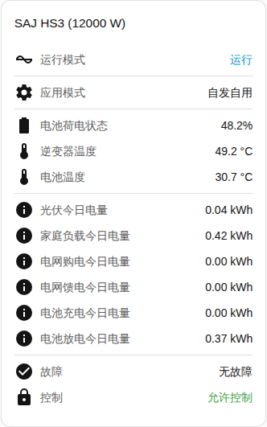

[en](../../../en-gb/user/cards/status-card.md) | [de](../../../de/user/cards/status-card.md) | [nl](../../../nl/user/cards/status-card.md) | [fr](../../../fr/user/cards/status-card.md) | zh | [es](../../../es/user/cards/status-card.md) | [it](../../../it/user/cards/status-card.md) | [pl](../../../pl/user/cards/status-card.md) | [sv](../../../sv/user/cards/status-card.md)

# 状态卡片

“状态卡片”页面说明状态卡片，该卡片在一处汇总一个系统。完整列表见卡片功能列表的 [状态卡片](../../../../frontend/docs/features.md#status-card) 一节。[添加元素](README.md#添加元素)说明如何添加该卡片并选择系统。

## 卡片显示什么

- 运行状态（按状态的健康程度着色）和应用模式。
- 电池荷电状态、逆变器和电池温度，以及离网模式。
- “显示今日电量”开启时（默认开启），卡片显示今日的光伏、负载、电网购电、电网馈电、电池充电和电池放电电量。
- 有当前故障的设备数量，或无故障。参见[设备故障](../faults-and-repairs.md#设备故障)。
- 该系统是否允许控制。参见[允许控制](../changing-settings.md#允许控制)。

## 型号之间的差异

- **仅 H2：** 当逆变器运行的应用模式与你选择的模式不同时，卡片还会显示当前运行的模式。只有当“应用模式（生效中）”实体已启用时，才会出现该行。该实体以禁用状态创建。参见[实体参考](../entities/README.md)。

## 选项

| 编辑器中的选项 | YAML 键 | 默认值 |
| --- | --- | --- |
| 系统 | `device` | 第一个系统 |
| 显示今日电量 | `show_energy` | 开 |

## 尚不支持

- 从卡片更改设置。状态卡片只显示。更改设置请使用[控制卡片](controls-card.md)。
