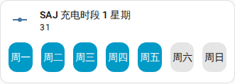

[en](../../../en-gb/user/cards/weekdays-feature.md) | [de](../../../de/user/cards/weekdays-feature.md) | [nl](../../../nl/user/cards/weekdays-feature.md) | [fr](../../../fr/user/cards/weekdays-feature.md) | zh | [es](../../../es/user/cards/weekdays-feature.md) | [it](../../../it/user/cards/weekdays-feature.md) | [pl](../../../pl/user/cards/weekdays-feature.md) | [sv](../../../sv/user/cards/weekdays-feature.md)

# 星期磁贴卡片功能

“星期磁贴卡片功能”页面说明星期功能，该功能在磁贴卡片上放置七个星期按钮，用来设置时段的星期。完整列表见卡片功能列表的 [星期磁贴卡片功能](../../../../frontend/docs/features.md#weekdays-tile-card-feature) 一节。时段的星期是充电、放电和充电桩时段的“星期”实体，列在实体参考的[电池](../entities/battery.md)和[充电桩](../entities/ev-charger.md)区域中。



## 添加该功能

1. 在仪表盘中添加一张磁贴卡片，并选择某个时段的“星期”实体作为该磁贴卡片的实体。
2. 打开该磁贴卡片的功能，选择“添加功能”，然后选取“SAJ Local 星期”。

只有当磁贴卡片的实体是某个时段的“星期”实体时，才会提供该功能。该功能没有选项。

```yaml
type: tile
entity: number.saj_charge_slot_1_days
features:
  - type: custom:saj-local-weekdays-feature
```

示例中的实体 ID 没有前缀。如果你设置了[前缀](../entities-and-prefix.md#前缀)，实体 ID 会在 `saj_` 之后带有该前缀。

## 按钮如何工作

- 七个带名称的星期按钮从你一周的第一天开始，该日期来自 Home Assistant 的设置或你的语言。
- SAJ Local 在最后一次按下之后 1.5 秒发送更改，因此你可以在一次更改中选择多个星期。
- 逆变器把星期存为一个数字，该数字不随你一周的第一天而变化。在每个型号上，周一是最低位，周日是最高位，因此周一到周五是 31（如截图所示），周一、周三和周五是 21。
- 当该系统的[允许控制](../changing-settings.md#允许控制)关闭时，这些按钮被禁用。

[计划卡片](schedule-card.md)在时段编辑器中使用这些按钮。

## 尚不支持

- 时段的“星期”实体以外的任何实体。SAJ Local 不为其他磁贴卡片提供该功能。
