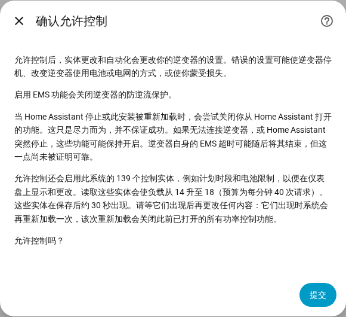

[en](../../en-gb/user/changing-settings.md) | [de](../../de/user/changing-settings.md) | [nl](../../nl/user/changing-settings.md) | [fr](../../fr/user/changing-settings.md) | zh | [es](../../es/user/changing-settings.md) | [it](../../it/user/changing-settings.md) | [pl](../../pl/user/changing-settings.md) | [sv](../../sv/user/changing-settings.md)

# 更改设置

“更改设置”页面说明如何允许 SAJ Local 更改你的逆变器的设置、更改之后会发生什么，以及哪些更改始终会被拒绝。完整列表见集成功能列表的 [更改设置](../../../custom_components/saj_local/docs/features.md#changing-settings) 和 [EMS](../../../custom_components/saj_local/docs/features.md#ems) 两节。设置和命令分布在[实体参考](entities/README.md)的各个区域中，主要是[设置](entities/settings.md)和[电池](entities/battery.md)。

在你为某个系统允许控制之前，向逆变器写入是关闭的。“允许控制”关闭时，设置会显示当前值，但会拒绝每一次更改，并给出说明在哪里开启控制的消息。不会向逆变器发送任何内容。

## 允许控制

1. 打开“配置”，即 SAJ Local 集成页面上该系统所在行的齿轮。你也可以在添加系统时开启“允许控制”。
2. 开启“允许控制”，然后选择“提交”。
3. 阅读确认内容，然后再次选择“提交”。

确认内容警告说，错误的设置可能使逆变器停机、改变逆变器使用电池或电网的方式，或使你蒙受损失。确认内容还说明：

- 启用 EMS 功能会关闭逆变器的防逆流保护。
- 当 Home Assistant 停止或系统重新加载时，SAJ Local 会尝试关闭你从 Home Assistant 打开的功能。该关闭只是尽力而为，并不保证成功。
- 允许控制会启用控制实体，读取这些实体会提高请求负载。对话框显示实体的数量以及之前和之后的负载。

仅 HS3：设置时的确认还会询问 EMS 心跳。在“配置”中，心跳是主表单上的一个字段。参见 [EMS](#ems)。

关闭“允许控制”不需要确认。每个系统都有一个“允许控制”二元传感器，属于诊断类别，在系统接受更改期间为开。[仪表盘卡片](cards/README.md)读取该传感器，并在该传感器为关时锁定控制项。该传感器是只读的，因为仪表盘上的开关会在没有警告的情况下开启写入。

## 控制项集合

大多数计划时段和许多设置都以禁用状态创建，因此仪表盘卡片将没有可显示或可更改的内容。因此，开启“允许控制”也会启用该系统的控制项集合：

- 充电、放电和充电桩时段（充电桩时段仅 HS3）；
- 应用模式和分时设置；
- 电池限值和电网限值；
- 充电桩设置（仅 HS3）；
- 功率控制开关和目标，参见[功率控制](power-control.md)；
- LED 模式、蜂鸣器（仅 H2），以及“同步时钟”和“清除当前故障”按钮。

电池包读数和其他只读实体不属于该集合。

- **实体约 30 秒后出现。** Home Assistant 会在系统的某个实体被启用 30 秒后重新加载该系统。请等实体出现后再更改任何内容，因为这次重新加载会关闭你在此期间打开的所有功率控制功能。当集合中的新成员稍后出现时（例如检测到充电桩之后出现充电桩时段），还会再重新加载一次。
- **关闭“允许控制”**会禁用 SAJ Local 启用的实体，并且不会再重新加载。
- **你的选择优先。** 你在开启控制之前禁用的实体保持禁用，你自己启用的实体保持启用。卡片会把含有已禁用实体的时段视为被排除在外。

## 更改后会发生什么

SAJ Local 在发送任何内容之前会先检查更改。在下列情况下，SAJ Local 会拒绝更改，每种情况都有单独的消息：

- 允许控制已关闭；
- 型号未验证。型号无法验证的系统绝不会被写入，参见[开始使用](getting-started.md#逆变器未被识别时)；
- 该设置是调试设置；
- 值无效；
- 无法访问逆变器；
- 达到写入限制。任意 60 秒内发往一个逆变器地址的更改不超过 20 次，超出限制的更改会被拒绝，不会排队。

每条消息都会说明逆变器未被更改。否则，SAJ Local 会写入更改一次并回读该值，实体显示逆变器所保存的值。

| 发生的情况 | 你看到的内容 |
| --- | --- |
| 逆变器拒绝了更改 | 消息给出异常码。 |
| 逆变器没有应答 | 消息说明该更改可能已生效也可能未生效。SAJ Local 不会再次发送任何内容，并在重新连接后再次读取逆变器。 |
| 逆变器保存的是另一个值 | 实体显示逆变器所保存的值，该更改失败。 |

对保存多项设置的一个寄存器中的某一项设置进行更改时，该寄存器的其他设置保持不变。

## 可以更改的内容

- 应用模式、七个充电时段和七个放电时段（每个都有开始、结束、功率、星期和开或关）、分时空闲模式和电网放电，以及备用电量。
- 电池充电和放电限值、电池自动唤醒、馈电限值、电网购电和馈电功率限值，以及被动模式功率。
- 仅 HS3：充电桩设置和七个充电桩时段。
- 仅 H2：蜂鸣器和电池强制充电功率限制。两个型号都有 LED 模式。
- 命令，以按钮形式提供，以禁用状态创建：清除当前故障、重启逆变器和同步时钟（发送 Home Assistant 的本地时间）。仅 HS3：移除 EMS 光伏功率限制。

[仪表盘卡片](cards/controls-card.md)把共用的设置集中在一处。控制卡片没有重启按钮，因此在仪表盘上点按不会重启逆变器。

## 调试设置

调试设置会显示，但无法从 Home Assistant 更改：电表、RS485、电池协议、网络和充电桩连接，在 H2 上还有电网类型、并机设置、输入模式、保护限值和其他安装人员设置。错误的值可能使逆变器与电表、电池、充电桩或 Home Assistant 断开。调试设置是诊断类别中的只读传感器。这类更改请在 SAJ elekeeper 应用中进行，参见[需求](../../../custom_components/saj_local/docs/requirements.md#changing-settings)。

## 尚不支持

- 恢复出厂设置和清除电量历史。SAJ Local 两者都不提供。
- 更改调试设置。
- 在型号未验证的系统上更改设置。

## EMS

仅 HS3：EMS 使逆变器处于外部控制之下。H2 没有 EMS 实体。SAJ Local 以实体形式提供 EMS 超时和五个限值：电池充电和放电电流、逆变器购电和馈电功率，以及光伏功率。这些限值可以设置，SAJ Local 不轮询这些限值。在两次心跳之间，这些限值显示 SAJ Local 最后发送的值，在第一次更改之前这些限值是未知的。[功率控制](power-control.md)打开和关闭 EMS 功能。

- **心跳使功能保持有效。** SAJ Local 每个心跳间隔都会读取你从 Home Assistant 打开的每个 EMS 功能的目标以及这些限值。读取算作 EMS 活动，因此心跳不写入任何内容。
- **默认间隔为 60 秒。** 你可以设置 30 到 3600 秒，可在设置时的“允许控制”确认中设置，也可在“配置”中设置。
- **超时必须长于心跳。** 当逆变器的 EMS 超时不长于心跳时，无法打开功能，并且超时也无法设得那么低。
- **停止时关闭。** 当 SAJ Local 卸载或 Home Assistant 停止时，SAJ Local 会关闭你打开的 EMS 功能。SAJ Local 加载时已经处于开启状态的功能不受影响。
- **关闭只是尽力而为。** 当无法访问逆变器，或 Home Assistant 突然停止时，这些功能保持开启。逆变器的 EMS 超时可能会结束这些功能，但 SAJ Local 不依赖该超时，参见[已在硬件上测试](#已在硬件上测试)。

## 已在硬件上测试

下面的说明指出哪些设置已在真实逆变器上试过，哪些仅依据现场反馈或 SAJ 协议文档。

HS3，在真实的 HS3 上逐个寄存器写入并回读：

- 应用模式、备用电量荷电状态、被动模式电池充电功率、EMS 超时、[功率控制](power-control.md)写入的四个 EMS 使能位，以及三个 EMS 目标和五个 EMS 限值。
- 在 HS3 上，被动模式电池充电功率设定备用模式的功率。
- 仅应用模式 EMS 会使逆变器空闲，家庭由电网供电，并且逆变器不会自行退出 EMS。
- EMS 超时在 5 秒后结束了 EMS，但在另一个客户端轮询逆变器期间，20 秒或 60 秒时没有结束 EMS。SAJ Local 不依赖该超时。
- 光伏功率限制只在某个 EMS 功能开启时才有效。
- 当某个 EMS 功能停止时，逆变器会回到它之前运行的应用模式。
- 分时（BMS）是 SAJ 应用选择应用的 TOU (BMS) 模式时 HS3 上报的模式，它不是应用的分时模式。SAJ Local 从未向逆变器写入过分时（BMS）。

H2，依据 H2 机组的现场反馈和 H2 协议文档建立，本项目未试过：

- 功率控制，它使用被动模式、计划时段、应用模式、被动模式功率、电池限值、电网功率限值和馈电限值。
- 削峰：现场反馈显示，在 SAJ 应用中选择了削峰，并通过 Modbus 回读和写入。H2 协议文档没有列出削峰。
- AI 节能是 SAJ 应用选择 AI 节能时 H2 上报的模式。SAJ Local 从未向逆变器写入过 AI 节能。

从未在真实逆变器上试过：

- LED 模式、H2 蜂鸣器和 H2 电池强制充电功率限制；
- 本节未提及的其他所有设置；
- 每一次写入多个寄存器的更改；
- 每一条命令。
