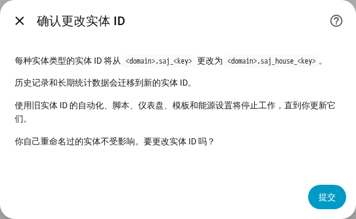

[en](../../en-gb/user/entities-and-prefix.md) | [de](../../de/user/entities-and-prefix.md) | [nl](../../nl/user/entities-and-prefix.md) | [fr](../../fr/user/entities-and-prefix.md) | zh | [es](../../es/user/entities-and-prefix.md) | [it](../../it/user/entities-and-prefix.md) | [pl](../../pl/user/entities-and-prefix.md) | [sv](../../sv/user/entities-and-prefix.md)

# 实体和前缀

“实体和前缀”页面说明系统的实体是什么、实体 ID 如何构成，以及如何为实体 ID 添加前缀。完整列表见集成功能列表的 [设备与实体](../../../custom_components/saj_local/docs/features.md#devices-and-entities) 和 [实体 ID 与前缀](../../../custom_components/saj_local/docs/features.md#entity-ids-and-prefix) 两节。每个实体的名称、ID、型号和默认值都在[实体参考](entities/README.md)中。

## 系统的实体

SAJ Local 为你的型号所知的每一个读数、设置和命令，都是该系统设备的一个实体。每个实体的类型都是 Home Assistant 用户对该读数或设置所期望的类型：传感器、二元传感器、数值输入器、选择、开关、时间或按钮。设置以其真实的控件类型显示，因此限值是数值输入器，开或关的设置是开关。

- **只启用一组核心实体。** 功率、电压、温度和荷电状态读数、电量计数器、主要的电池限值以及每一个故障都会启用。其他所有实体都以禁用状态创建。
- **已禁用的实体不会被读取。** 启用某个实体会把该实体加入下一次读取。禁用某个实体会停止读取其寄存器。[轮询](polling.md)说明你的选择会给逆变器带来多大开销。
- **系统只得到合适的实体。** 只有一路光伏组串的 H2 没有第二路组串的实体。未安装的设备不创建实体，参见[可选设备](optional-equipment.md)。
- **设置和诊断分组显示。** 设置属于配置类别。版本、调试设置和网络设置属于诊断类别。
- **未知选项显示为未知。** 该选项的代码在[诊断下载](troubleshooting.md#下载诊断)中，因此可以报告该选项。

当你为未被识别的逆变器手动设置型号时，系统会得到所选型号的每个实体，其中超出一相和两路光伏组串的实体处于禁用状态。参见[开始使用](getting-started.md#逆变器未被识别时)。

## 功率的符号

电池功率和电网功率在每个型号上使用同一种符号，因此一个读数在 HS3 和 H2 上含义相同。

- **电池功率**在电池放电时为正，在电池充电时为负。
- **电网功率**在系统馈电时为正，在系统购电时为负。电表 A 遵循电网的符号。
- **电表 B** 在其测量的光伏逆变器发电时为正。

在 HS3 上，电网功率是电表 A 的总和，电网相功率、视在功率、电流和功率因数来自电表 A 的对应相，因为 HS3 的电网寄存器中是逆变器的值。没有电表 A 的 HS3 没有这些实体。家庭负载功率是三个并网输出相功率之和。

[功率控制](power-control.md)的目标遵循读数的符号。

## 计算得出的传感器

八个传感器由系统自身的读数计算得出，每个型号都有。

- **电池充满所需时间**和**电池放空所需时间**是以分钟为单位的时长。每个值用剩余的电池能量除以最近 10 分钟的平均电池功率，因此家庭负载的短时变化不会让数值跳动。充满所需时间只在平均功率为电池充电时有值，放空所需时间只在平均功率使电池放电时有值。平均功率为零时，以及结果超过 48 小时时，数值未知。重新加载或重启后，平均值从头开始。
- **电池储存能量**和**电池可用能量**以 kWh 为单位。储存能量是荷电状态乘以电池能量。可用能量是放空限值以上的能量，且不会小于 0。
- **充满与放空。** 充满是充电限值。放空在备用模式下是备用电量，在其他应用模式下是并网放电限值。离网时，放空是有离网放电限值的型号的离网放电限值。
- **电池能量。** H2 报告可用容量，SAJ Local 将它乘以电池电压。HS3 不报告可用容量，因此 SAJ Local 根据电池功率和荷电状态的变化学习容量。在 HS3 上，四个电池能量传感器在荷电状态于两次轮询之间变化之前一直未知。电池充放电越多，学到的容量越准确。SAJ Local 在重启后保留学到的容量。
- **今日自给率**是今日负载能量中不来自电网的份额。**今日自用率**是今日太阳能能量中未被输出的份额。**电池往返效率**是电池总放电能量除以电池总充电能量。每个值都是 0 到 100 的百分比，除数为 0 时未知。
- **光伏盈余功率**是光伏功率减去家庭负载功率，单位为瓦。负载大于光伏功率时，数值为负。
- **默认值。** 上述四个电池传感器默认启用，另外四个以禁用状态创建。时间、能量和往返效率传感器仅在装有电池时存在。
- **读取。** 启用计算得出的传感器时，会读取该传感器所需的每个读数，即使这些读数的实体已禁用。[轮询](polling.md)把这些读取计入负载。

## 前缀

每个实体 ID 的形式为 `<type>.saj_<key>`，例如 `sensor.saj_pv_power`。重命名实体的显示名称不会改变 ID。

前缀会在一个系统的每个实体 ID 中 `saj_` 之后添加一个词，例如 `sensor.saj_house_pv_power`。有多个 SAJ 系统时请使用前缀，这样就不需要在任何实体 ID 后加编号。

- 只能使用小写字母和数字，最多 32 个字符。
- 两个系统不能使用同一个前缀，并且只有一个系统可以没有前缀。
- 会与实体名称冲突的前缀（例如 `battery`）会被拒绝。
- 如果系统将要创建的某个实体 ID 已被占用，设置会被拒绝。

### 添加、更改或移除前缀

1. 打开“配置”，即 SAJ Local 集成页面上该系统所在行的齿轮。
2. 更改“前缀”字段，然后选择“提交”。
3. 阅读确认内容，然后再次选择“提交”。

确认内容显示旧的和新的模式。使用旧实体 ID 的自动化、脚本、仪表盘、模板和能源设置会停止工作，直到你更新这些引用。

你确认之后：

- SAJ Local 会重命名系统的每个实体（无论已启用还是已禁用），Home Assistant 会把历史记录和长期统计数据迁移到新的 ID。
- 你自己重命名过的实体不受影响。
- [仪表盘卡片](cards/README.md)继续工作，因为卡片通过实体注册表而不是通过 ID 查找实体。

当新的 ID 已被占用，或 Home Assistant 已在某个新 ID 下保存了长期统计数据（例如来自你删除的、曾使用该前缀的系统）时，SAJ Local 会拒绝更改，并且不重命名任何实体。

如果以后的版本添加了某个实体，而该实体的 ID 已被占用，Home Assistant 会在该 ID 后加上编号，并在日志中给出警告，指出该实体的类型和键。

## 尚不支持

- 选择实体 ID 的键部分。SAJ Local 固定键，因此仪表盘和自动化在每个型号上的工作方式完全相同。
