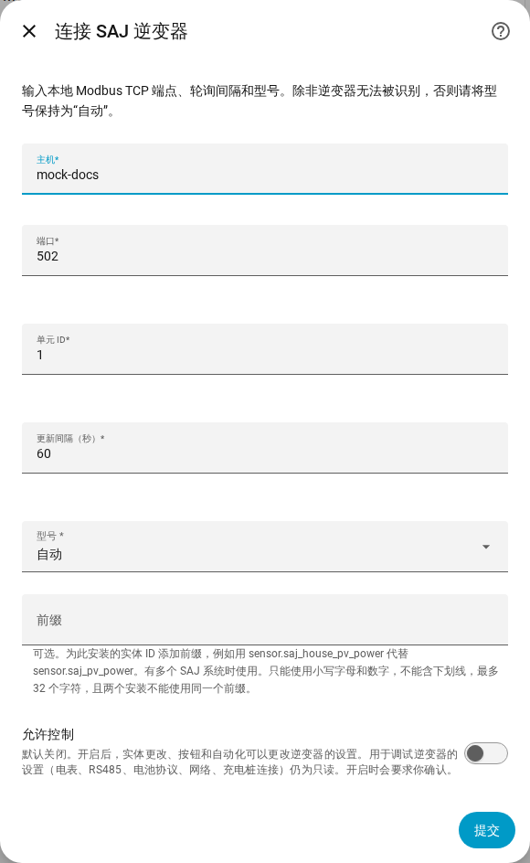
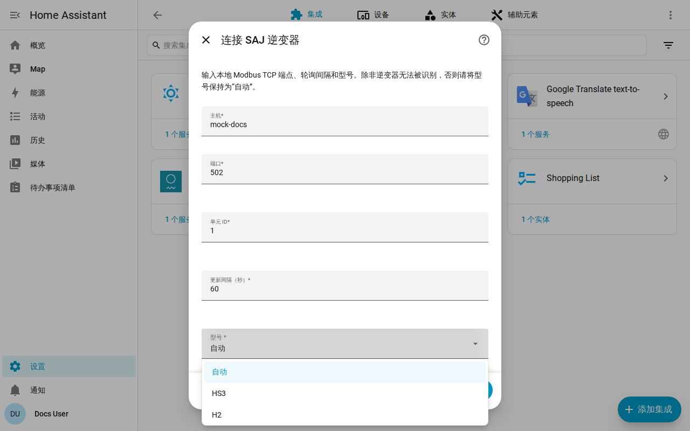

[en](../../en-gb/user/getting-started.md) | [de](../../de/user/getting-started.md) | [nl](../../nl/user/getting-started.md) | [fr](../../fr/user/getting-started.md) | zh | [es](../../es/user/getting-started.md) | [it](../../it/user/getting-started.md) | [pl](../../pl/user/getting-started.md) | [sv](../../sv/user/getting-started.md)

# 开始使用

“开始使用”页面把你的 SAJ 系统添加到 Home Assistant，并说明添加之后你会得到什么。设置过程所做事项的完整列表见集成功能列表的 [设置与检测](../../../custom_components/saj_local/docs/features.md#setup-and-detection) 一节。请先[安装 SAJ Local](installation.md)，并确认你的逆变器在[支持的设备](supported-equipment.md)之列。

## 添加系统

1. 在 Home Assistant 中打开“设置”，然后打开“设备与服务”。
2. 选择“添加集成”，搜索 SAJ Local。
3. 填写表单，然后选择“提交”。

| 字段 | 填写内容 |
| --- | --- |
| 主机 | 逆变器的主机名或 IP 地址。 |
| 端口 | Modbus TCP 端口。默认为 502。 |
| 单元 ID | Modbus 单元 ID，范围为 1 到 247。默认为 1。 |
| 更新间隔（秒） | 每个已启用实体的读取频率。默认为 60，最小为 10。参见[轮询](polling.md)。 |
| 型号 | 保持为“自动”。SAJ Local 根据逆变器上报的设备类型识别 HS3 和单相 H2。 |
| 前缀 | 可选。第一个系统请留空。参见[实体和前缀](entities-and-prefix.md#前缀)。 |
| 允许控制 | 默认关闭，因此任何东西都无法更改设置。参见[更改设置](changing-settings.md)。 |

SAJ Local 连接逆变器，读取逆变器的标识和六项核心读数（运行模式、电池荷电状态、负载功率、光伏功率、电池功率和电网功率），然后创建系统。某台设备缺少某个寄存器不会中断设置。系统的标题为 SAJ 加上逆变器的序列号。

设置失败时，表单会说明出了什么问题：无法连接、未及时应答、读取被拒绝、数据无效、设备未被识别，或型号与逆变器不符。检查通过之前不会保存任何内容。

## 你会得到什么

- 一个名为 SAJ 的 Home Assistant 设备。设备的型号显示型号和额定功率，例如 HS3 (12000 W)。
- 与你的型号和设备相符的实体。SAJ Local 会为你检测电池、电表和其他设备，参见[可选设备](optional-equipment.md)。
- 只启用一组核心实体。其他实体都以禁用状态创建，因此不会读取逆变器上你没有要求的值。在 Home Assistant 中启用某个实体后，下一次读取就会包含该实体。参见[实体和前缀](entities-and-prefix.md)。
- [仪表盘卡片](cards/README.md)，无需安装任何东西。

## 添加第二个系统

在“设备与服务”中再次添加 SAJ Local。SAJ Local 会拒绝已经设置过的端点或逆变器序列号。请为每个系统设置不同的[前缀](entities-and-prefix.md#前缀)，这样就不需要在任何实体 ID 后加编号。

## 逆变器未被识别时

当逆变器上报的设备类型 SAJ Local 无法识别时，“自动”会失败，并给出要求你手动选择型号的错误。在“型号”字段中选择 HS3 或 H2。

- 与已识别的逆变器相矛盾的选择会被拒绝。请选择错误中给出的型号，或选择“自动”。
- 对于未识别的逆变器，SAJ Local 读取必需的寄存器，并要求你确认型号。这些寄存器必须先应答。
- 设备随后会把该型号显示为未验证。读数可能有误，因为 SAJ Local 无法对照设备类型核对读数，并且每一次更改设置的尝试都会被拒绝。

## 之后更改系统

打开“配置”，即 SAJ Local 集成页面上该系统所在行的齿轮。你可以更改主机、端口、单元 ID、更新间隔、型号、前缀和允许控制，并设置每一项设备。SAJ Local 只有在逆变器在新端点应答之后才会保存更改。新的逆变器见[更换逆变器](replacing-the-inverter.md)。

## 尚不支持

- HS3 和单相 H2 以外的产品。参见[支持的设备](supported-equipment.md)。
- 在网络上查找逆变器。你需要自己输入逆变器的地址。
