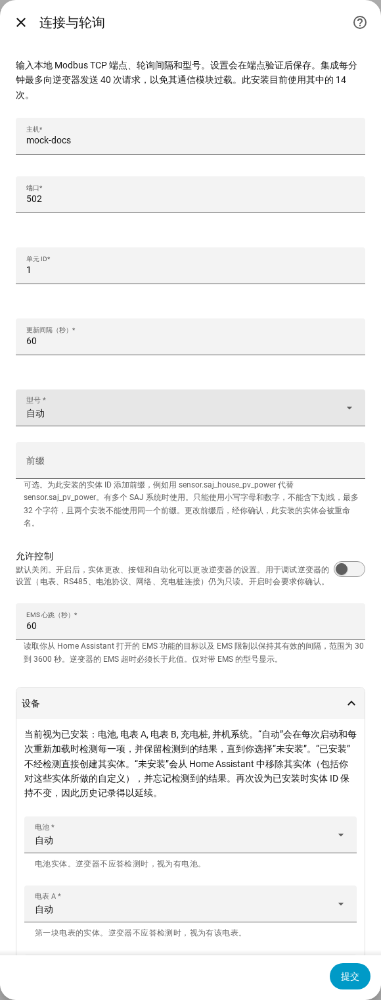

[en](../../en-gb/user/optional-equipment.md) | [de](../../de/user/optional-equipment.md) | [nl](../../nl/user/optional-equipment.md) | [fr](../../fr/user/optional-equipment.md) | zh | [es](../../es/user/optional-equipment.md) | [it](../../it/user/optional-equipment.md) | [pl](../../pl/user/optional-equipment.md) | [sv](../../sv/user/optional-equipment.md)

# 可选设备

“可选设备”页面说明 SAJ Local 如何得知你的逆变器配有哪些可选设备，以及如何覆盖检测结果。完整列表见集成功能列表的 [可选设备](../../../custom_components/saj_local/docs/features.md#optional-equipment) 一节。[支持的设备](supported-equipment.md)页面说明哪个型号可以配备什么，[实体参考](entities/README.md)说明每种设备增加哪些实体。

## SAJ Local 检测什么

设置时不会询问任何设备信息。SAJ Local 每次加载时（包括每次 Home Assistant 启动和每次重新加载）都会询问逆变器装了什么，并且只为这些设备创建实体。

| 设备 | 型号 |
| --- | --- |
| 电池 | HS3 和 H2 |
| 电表 A，电网电表 | HS3 和 H2 |
| 电表 B，第二块电表 | HS3 和 H2 |
| 并机系统 | HS3 和 H2 |
| 充电桩 | 仅 HS3 |

- **逆变器不应答检测：** SAJ Local 假定有电池和电表 A，不假定有其他设备。
- **重启期间某块电表离线：** 已检测到的设备会被记住，因此该设备保留其实体。
- **之后才安装的设备：** SAJ Local 在下一次重启或重新加载时发现该设备。

## 已记住的设备不再被检测到时

SAJ Local 保留该设备的实体，因此历史记录和仪表盘保持不变，并在 Home Assistant 中提出一个修复问题。该问题会指出设备和系统。请检查该设备，或按下文所述把该设备设为“未安装”。在下一次再次检测到该设备的加载时，或在你更改该设置时，该问题会消失。

## 覆盖检测

1. 打开“配置”，即 SAJ Local 集成页面上该系统所在行的齿轮。
2. 展开“设备”部分。
3. 把每一项设备设为“自动”、“已安装”或“未安装”，然后选择“提交”。

该部分还会列出 SAJ Local 当前视为已安装的设备。

| 设置 | 作用 |
| --- | --- |
| 自动 | 在每次启动和每次重新加载时检测设备，并保留检测到的结果，直到你选择“未安装”。“自动”是默认值。 |
| 已安装 | 不经检测直接创建设备的实体。 |
| 未安装 | 从 Home Assistant 中移除设备的实体，包括你对这些实体所做的更改，例如新名称。SAJ Local 会忘记检测到的结果。 |

实体 ID 保持不变，因此如果你把设备重新设为“已安装”或“自动”，历史记录会延续。未安装设备的实体无法被读取、轮询或写入。

该部分只列出你的型号可以配备的设备。仅 HS3：充电桩。

## 电池包

- **H2：** H2 会上报自己有多少个电池包，最多五个。SAJ Local 按该数量创建电池包实体。数量为 0 时保留每个电池包的实体。SAJ Local 会记住它见过的最大数量。每个电池包都有标识实体，以禁用状态创建。
- **HS3：** HS3 有一个电池包的实体。

## 充电桩

仅 HS3：带充电桩的 HS3 还会得到该充电桩的读数、设置、充电时段和 EMS 充电控制项。其中大多数以禁用状态创建。开启“允许控制”会启用这些设置和时段，参见[更改设置](changing-settings.md#控制项集合)。

## 尚不支持

- SAJ Local 不检测的设备。表中的设备就是完整列表。
- 在 H2 上检测充电桩。
