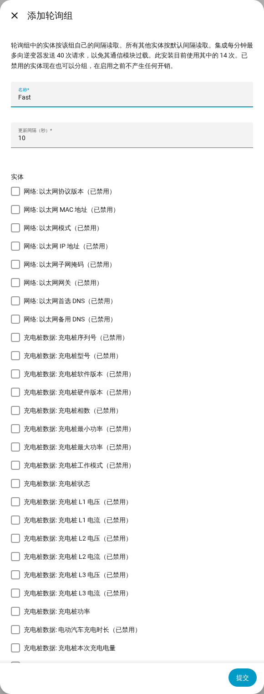

[en](../../en-gb/user/polling.md) | [de](../../de/user/polling.md) | [nl](../../nl/user/polling.md) | [fr](../../fr/user/polling.md) | zh | [es](../../es/user/polling.md) | [it](../../it/user/polling.md) | [pl](../../pl/user/polling.md) | [sv](../../sv/user/polling.md)

# 轮询

“轮询”页面说明 SAJ Local 多久读取一次逆变器，以及如何让某些实体读取得更快或更慢。完整列表见集成功能列表的 [轮询](../../../custom_components/saj_local/docs/features.md#polling) 一节。适用于每个请求的限制见[保护逆变器](protecting-the-inverter.md)。

SAJ Local 在你的本地网络上通过 Modbus TCP 读取逆变器，读取计划由你控制。任何数据都不会离开你的网络。

## 默认间隔

默认情况下，每个已启用的实体每 60 秒读取一次。在“配置”（即 SAJ Local 集成页面上该系统所在行的齿轮）中更改“更新间隔（秒）”字段。间隔不会短于 10 秒。

只读取已启用的实体。在 Home Assistant 中禁用某个实体后，该实体的寄存器不再被读取。

## 轮询组

轮询组以快于或慢于默认值的频率读取选定的实体。例如，可以用一个组每 10 秒读取一次负载、光伏、电池和电网功率，而其他所有内容保持 60 秒。

1. 在 SAJ Local 集成页面上，打开该系统所在行的菜单，选择“添加轮询组”。页面顶部的“添加轮询组”按钮也会打开“添加轮询组”表单。
2. 输入名称、更新间隔（秒，至少 10）以及该组的实体。
3. 选择“提交”，阅读检查结果，然后选择“保存此组”。

- **任意实体：** 一个组可以包含任何类型的实体。也可以选择已禁用的实体，在你启用该实体之前不产生任何开销。
- **最多一个组：** 一个实体最多属于一个组。不在任何组中的实体都保持默认间隔。
- **寄存器顺序：** 表单按寄存器顺序列出实体，并为每个实体标注其读取所在的寄存器数据块，因此可以共用一次请求的实体排在一起。
- **编辑或删除：** 在集成页面上打开该轮询组。更改或删除轮询组会保留这些实体、实体的名称以及实体的历史记录。

一个系统的所有间隔共用同一个时钟，因此同时到期的实体会一起读取。超时的读取不会补读。错过的时刻被丢弃，轮询从下一个时刻继续。

## 请求负载

SAJ Local 在任意 60 秒内向逆变器发送的请求最多 40 次。表单以每分钟请求数对照该限制，显示你的选择所需的开销。上面的表单以每分钟 14 次请求的当前负载为例。

- **保存组之前：** 检查步骤显示读取该组一次需要多少请求，以及保存前后的负载。
- **超出限制：** 你仍然可以保存该组。检查步骤会警告读取会比你配置的更慢，因为 SAJ Local 绝不会发送超过限制的请求。
- **新的默认间隔：** 当新的间隔使负载超出限制时，“配置”会要求你确认。
- **更少的请求：** 位于同一个寄存器数据块中的实体只需一次请求。位于不同数据块中的实体每个需要一次请求。

在 Home Assistant 中启用某个实体，表单无法拦截。这种情况下，[诊断下载](troubleshooting.md#下载诊断)会列出计划负载与限制的对照。

## 尚不支持

- 间隔低于 10 秒的轮询组。
