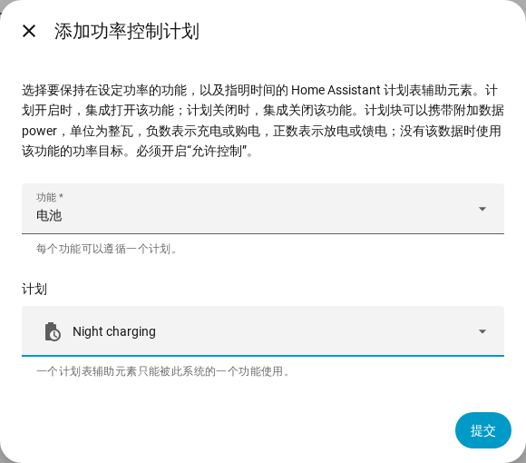

[en](../../en-gb/user/power-control.md) | [de](../../de/user/power-control.md) | [nl](../../nl/user/power-control.md) | [fr](../../fr/user/power-control.md) | zh | [es](../../es/user/power-control.md) | [it](../../it/user/power-control.md) | [pl](../../pl/user/power-control.md) | [sv](../../sv/user/power-control.md)

# 功率控制

“功率控制”页面说明如何手动或借助 Home Assistant 计划表，让电池、电网连接点或逆变器保持在设定的功率。完整列表见集成功能列表的 [功率控制](../../../custom_components/saj_local/docs/features.md#power-control) 一节。开关和目标在实体参考的[集成添加的实体](entities/added-by-the-integration.md)中。

功率控制在每个提供功能的型号上的工作方式相同。当[允许控制](changing-settings.md#允许控制)关闭或型号未验证时，功率控制不起任何作用。

| 功能 | 该功能让什么保持在设定功率 | HS3 | H2 |
| --- | --- | --- | --- |
| 电池 | 电池充电或放电。 | 是 | 是 |
| 电网 | 电网连接点购电或馈电。需要电表 A。 | 是 | 否 |
| 逆变器 | 逆变器吸入或输出功率。 | 是 | 否 |

正功率表示放电、馈电或输出。负功率表示充电、购电或吸入。符号遵循读数的[功率的符号](entities-and-prefix.md#功率的符号)。

## 让功能保持在设定功率

每个功能都有一个开关和一个以整瓦为单位的功率目标。两者都以禁用状态创建，并属于配置类别。开启“允许控制”会启用这些开关和目标，参见[控制项集合](changing-settings.md#控制项集合)。

1. 设置该功能的功率目标。该目标会被舍入到逆变器支持的最近步长，并显示逆变器所保持的功率。
2. 打开该功能。功能需要有功率目标之后才能打开。
3. 要停止，请关闭该功能。

- 该目标在重启后保留，并在功能启动时发送。功能运行期间更改目标，会立即发送新的功率。
- 同一时间只运行一个功能。在另一个功能运行时打开某个功能会被拒绝，消息会指出正在运行的功能。
- 只要逆变器上报该功能正在运行，开关就为开，即使该功能是在 Home Assistant 之外启动的。
- 失败的启动会被撤销。失败的停止会每隔一个心跳间隔重新发送，直到逆变器上报该功能已停止。
- [仪表盘控制卡片](cards/controls-card.md)为每个功能显示一个开关、一个目标和一条关于符号的提示。

### Home Assistant 停止时

你从 Home Assistant 打开的功能，在 SAJ Local 卸载时以及 Home Assistant 停止时会被关闭。SAJ Local 加载时已在运行的功能保持运行。

- 仅 HS3：EMS 心跳使功能保持有效。突然停止之后，逆变器的 EMS 超时可能会结束该功能，但 SAJ Local 不依赖该超时。参见 [EMS](changing-settings.md#ems)。
- 仅 H2：因突然停止而保持运行的功能会一直运行，直到你关闭该功能。

## 遵循计划

功率控制计划使功能遵循一个 Home Assistant 计划表辅助元素。计划开启时功能开启，计划关闭时功能关闭。

1. 在 Home Assistant 中创建一个计划表辅助元素：设置，设备与服务，辅助元素，创建辅助元素，计划表。设置计划的时间和星期。
2. 在 SAJ Local 集成页面上，打开该系统所在行的菜单，选择“添加功率控制计划”。
3. 选择功能和计划表辅助元素，然后选择“提交”。

计划表辅助元素的一个计划块可以携带附加数据 `power`，单位为整瓦，符号如上所述，例如 `power: -600` 表示以 600 W 为电池充电。没有 `power` 时，SAJ Local 使用该功能的功率目标。

- 每个功能遵循一个计划，一个计划表辅助元素只驱动一个系统的一个功能。
- 计划会跟随辅助元素的重命名。不在实体注册表中的辅助元素会被拒绝，因此请选择你在界面中创建的辅助元素。
- “允许控制”关闭时，SAJ Local 会拒绝计划。
- 从集成页面更改或移除计划。你这样做时，系统会重新加载。

### 计划的作用

| 情形 | 发生的事情 |
| --- | --- |
| 计划开启且没有功能在运行 | SAJ Local 根据计划块设置功率，或使用功率目标，然后启动该功能。 |
| 计划块没有 `power`，且该功能没有功率目标 | 不会启动任何功能。该操作保持未完成，并给出警告。 |
| 该功能已在运行 | 当计划块有 `power` 时，SAJ Local 更改功率，并接管该功能。 |
| 另一个功能正在运行 | 不写入任何内容。该操作保持未完成。 |
| 启动被拒绝或失败 | 该操作保持未完成。SAJ Local 每隔一个心跳间隔重试一次。 |
| 计划块的 `power` 不是整数，或不在目标的范围内 | 不会启动任何功能。该操作保持未完成，并给出警告。 |
| 计划转入另一个 `power` 不同的计划块 | SAJ Local 更改功率。 |
| 计划开启期间你手动关闭了该功能 | 该功能保持关闭，直到计划下一次开启。 |
| 计划关闭，且该功能是 SAJ Local 启动的 | SAJ Local 停止该功能。 |

在没有任何需求且没有未完成操作时，SAJ Local 不发送任何内容。[诊断下载](troubleshooting.md#下载诊断)列出每个功能、每个计划以及未完成的操作。

## 尚不支持

- H2 上的电网和逆变器功率控制。
- 同时运行多个功能。
- 为一个功能设置多个计划。
