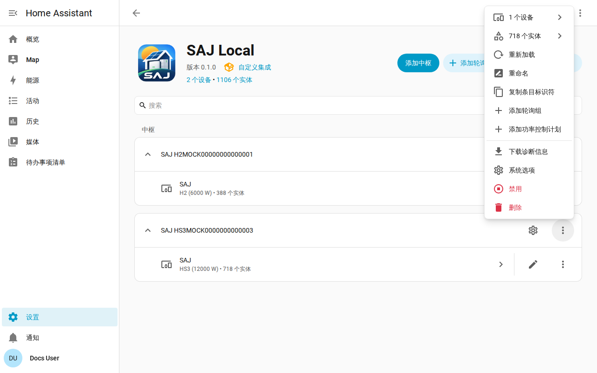

[en](../../en-gb/user/troubleshooting.md) | [de](../../de/user/troubleshooting.md) | [nl](../../nl/user/troubleshooting.md) | [fr](../../fr/user/troubleshooting.md) | zh | [es](../../es/user/troubleshooting.md) | [it](../../it/user/troubleshooting.md) | [pl](../../pl/user/troubleshooting.md) | [sv](../../sv/user/troubleshooting.md)

# 故障排查

“故障排查”页面说明如何下载诊断、开启调试日志，以及如何阅读常见问题。完整列表见集成功能列表的 [诊断与调试日志](../../../custom_components/saj_local/docs/features.md#diagnostics-and-debug-logging) 一节。

诊断下载和调试日志会显示逆变器返回了什么，以及 SAJ Local 对这些读数做了什么，同时不会泄露你是谁、在哪里。两者都使用 Home Assistant 的工具，因此无需安装任何东西，也不会向任何地方发送任何内容。

## 先看实体和修复问题

- 在[“设置”下的“修复”](faults-and-repairs.md#修复问题)中查看该系统是否有修复问题。每个问题都会说明哪里出了问题以及该怎么做。
- 当逆变器上报问题时，查看[设备故障](faults-and-repairs.md#设备故障)。
- 在被拒绝之后显示为不可用的实体，参见[保护逆变器](protecting-the-inverter.md#逆变器拒绝某个读数时)。

## 下载诊断

1. 打开“设置”，然后打开“设备与服务”，再打开 SAJ Local。
2. 打开该系统所在行的菜单，选择“下载诊断信息”。

该文件包含：

- 已启用的实体、各个间隔及其各自需要的请求数，以及计划负载与每分钟 40 次请求的限制的对照；
- 被拒绝和已暂停的实体；
- 当前故障及其原始字，以及以寄存器和位表示的未识别故障位；
- 打开的修复问题，以及逆变器已持续失败多久；
- 功率控制功能、正在运行的功能、SAJ Local 拥有的功能，以及每个计划尚未完成的操作；
- 自系统加载以来 SAJ Local 读取过的每个寄存器的原始字的快照，附带每个字的存在时间，使维护人员可以对照真实设备核对读数；
- 每一个没有得到可用应答的请求及其原因。超时的请求与被逆变器拒绝的请求看起来不同，当其他客户端占用逆变器的连接时，这一区别很重要。

该快照不会给逆变器增加任何请求。每次系统加载时，该快照都从空开始。

## 开启调试日志

1. 打开 SAJ Local 集成页面。
2. 打开集成页面的三点菜单，选择“启用调试日志”。
3. 如果系统设置失败，请从系统的菜单重新加载系统，使日志涵盖设置过程。
4. 重现问题。
5. 选择“禁用调试日志”。Home Assistant 会下载日志。

调试日志记录每一次连接、轮询、请求、写入、心跳和计划更改，每个事件一行。每一行日志都以系统的标题开头，后面是只保留最后三个字符的序列号，因此可以区分来自两个系统的日志行。标题中含有序列号时，序列号会就地被遮盖，例如 `SAJ xxxxx123`。

## 文件和日志不包含的内容

诊断和日志绝不包含主机、端口、单元 ID、完整序列号、MAC 地址、网络地址、充电桩序列号、前缀或轮询组名称。在寄存器快照中，保存网络地址和序列号的寄存器的字会被替换为 Home Assistant 的脱敏标记，因此你可以看到该寄存器有应答，却看不到该寄存器的内容。

## 常见问题

| 你看到的现象 | 要检查什么 |
| --- | --- |
| 设置失败，提示无法连接或没有应答 | 主机、端口和单元 ID。确认没有其他 Modbus 客户端占用逆变器的连接。 |
| 设置提示设备未被识别 | 手动选择型号。参见[开始使用](getting-started.md#逆变器未被识别时)。 |
| 某个设置拒绝更改 | 允许控制已关闭、型号未验证，或该设置是调试设置。消息会说明是哪一种。参见[更改设置](changing-settings.md)。 |
| 读取比你设置的间隔更慢 | 负载超出每分钟 40 次请求的限制。参见[轮询](polling.md#请求负载)。 |
| 你启用的实体还没有值 | Home Assistant 在你启用实体约 30 秒后重新加载系统，并从下一次读取开始读取该实体。 |
| 实体 ID 多了编号 | 该实体想要的 ID 已被占用。参见[实体和前缀](entities-and-prefix.md#前缀)。 |
| 实体缺失 | 该设备未被检测到，或被设为“未安装”。参见[可选设备](optional-equipment.md)。 |

## 帮助与反馈

欢迎在[问题跟踪器](https://github.com/Counterphase-Labs/ha-saj-local/issues)上提出问题、报告错误和分享想法。集成的问题请打开“Bug report”表单，仪表盘卡片的问题请打开“Card bug report”表单。“Bug report”表单要求附上诊断下载文件。安全问题请私下报告，参见[安全政策](../../../SECURITY.md)。
